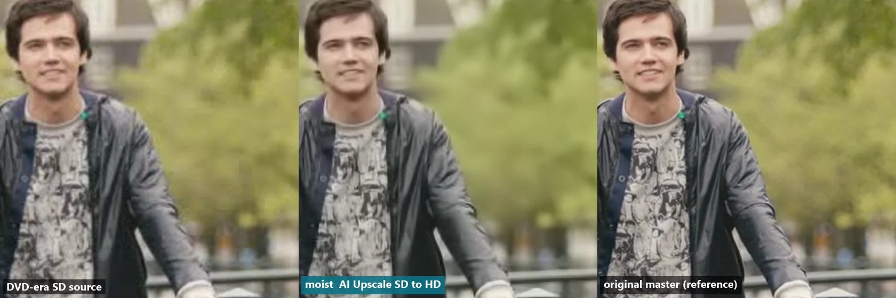
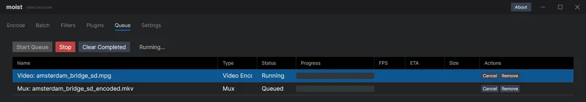
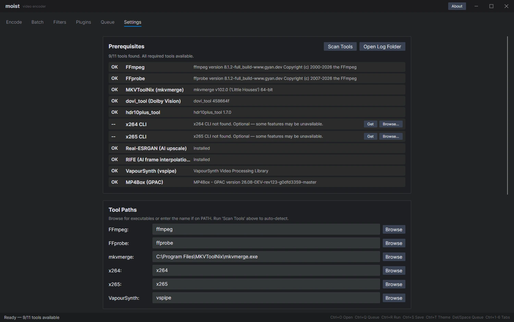

<p align="center">
  <picture>
    <source media="(prefers-color-scheme: dark)" srcset="docs/media/banner-dark.svg">
    
  </picture>
</p>

<p align="center">
  <a href="https://github.com/bogware/moist/actions/workflows/ci.yml"></a>
  <a href="https://github.com/bogware/moist/releases/latest"></a>
  
  
  <a href="LICENSE"></a>
</p>

<p align="center">
  <b>A modern, cross-platform front end for FFmpeg, x264, x265, SVT-AV1 and friends —<br>
  with a GUI, a CLI, an HTTP API, and a deep distrust of exit code zero.</b>
</p>

<p align="center">
  <a href="#-get-it">Get it</a> ·
  <a href="#-say-what-you-want-not-what-you-guess">Target quality</a> ·
  <a href="#-restoration-that-tells-the-truth">Restoration</a> ·
  <a href="#-nothing-is-trusted">Verification</a> ·
  <a href="docs/features.md">Feature guide</a> ·
  <a href="docs/cli.md">CLI</a> ·
  <a href="docs/faq.md">FAQ</a>
</p>

---

Yes, it's called **moist**. You'll get over it. Your videos already have.

<p align="center">
  
  <br><sub>A DVD-era 640×360 copy of a film scene → moist's built-in <b>AI Upscale SD to HD (GPU)</b> profile, one click, 1080p out.<br>
  <i>Tears of Steel</i> © Blender Foundation, CC BY 3.0 — degraded and re-encoded here for demonstration.</sub>
</p>

## ✨ Why moist

Encoding video is easy. Encoding it **right** — and *knowing* you did — is the part nobody automates. moist does.

- 🎯 **Ask for a quality, not a number.** `--target-vmaf 95` finds the CRF that actually gets you there, from a few short samples, using the very encoder you'll encode with. Measured: predicted 93.39, delivered **93.46**.
- 🔍 **It checks its own work.** FFmpeg will happily exit zero after writing a file a few frames short. moist counts frames, probes codecs, checks durations and timestamps — and fails loudly rather than shipping a quiet mistake.
- 🎞️ **Restores old footage** — de-block, denoise, GPU neural upscaling or Real-ESRGAN, inverse telecine for broadcast film — and is honest about what restoration can't do.
- ⚡ **Uses your GPU, but believes nothing.** Every hardware encoder is test-driven before it's offered. NVENC: **17× faster** than x265 at the same VMAF.
- 🧱 **Hard to lose work.** The queue survives a crash, chunked encodes resume, temp files are kept on failure, and a hung tool is killed instead of waited on forever.
- 🖥️ **One pipeline, four front doors.** GUI, CLI, watch folders and an HTTP API all build jobs through the same code — the GUI and the command line produce identical output.
- 🌈 **Doesn't lose half your file.** Every audio track, chapters, fonts, HDR10 metadata, 10/12-bit depth — and, opt-in, Dolby Vision and HDR10+ dynamic metadata.

<p align="center">
  
  <br><sub>Pick a profile, hit <b>Render output</b>, and see the real result — the whole pipeline, not just the filters — before you commit an hour of CPU.</sub>
</p>

## 🚀 Get it

**Download** the latest build from [Releases](https://github.com/bogware/moist/releases/latest). Everything is self-contained — no .NET runtime to install.

| | GUI | Command line |
|---|---|---|
| **Windows x64** | `moist-<version>-win-x64.zip` → run `Moist.App.exe` | `moist-cli-<version>-win-x64.zip` → `moist.exe` |
| **Linux x64** | `moist-<version>-linux-x64.tar.gz` → `./Moist.App` | `moist-cli-<version>-linux-x64.tar.gz` → `./moist` |
| **macOS** | [build from source](docs/development.md#build-from-source) | [build from source](docs/development.md#build-from-source) |

Every release ships a `SHA256SUMS.txt` — `sha256sum -c SHA256SUMS.txt --ignore-missing`.

**FFmpeg** is the one thing moist can't ride without. Either let moist fetch it — **Settings → Prerequisites → Install** (downloads are pinned and SHA-256-verified) — or put it on your PATH (`winget install Gyan.FFmpeg`, `brew install ffmpeg`, `sudo apt install ffmpeg`). A *full* build unlocks AV1 and VMAF; `moist tools` tells you exactly what yours has.

**First encode:**

```bash
# GUI: drag a file onto the window — or open one directly
Moist.App.exe holiday.mov

# CLI: sensible defaults (x265, Opus, MKV), or ask for a quality
moist encode holiday.mov
moist encode holiday.mov -o holiday.mp4 --target-vmaf 95
```

## 🎯 Say what you want, not what you guess

CRF is a dial with no units. "CRF 23" says nothing about how *your* footage will look. So moist encodes a few short samples from across the file, measures each with VMAF, and bisects to the CRF that lands on your target:

<p align="center">
  
</p>

Does sampling predict the whole file? Measured, not assumed:

| | Predicted from 3 × 5 s samples | Actual full encode |
|---|---|---|
| VMAF | 93.39 | **93.46** |
| Size | 64 % of source | 61 % |

Go further with **per-scene quality** (`--chunked --per-scene --target-vmaf 95`): every scene gets its own CRF. Against a fixed CRF chosen so no scene falls short, it delivers the same worst-case quality **15 % smaller** — and moist *re-checks* its own per-scene predictions, because compressibility and perceptual tolerance aren't the same thing. [The full story →](docs/features.md#per-scene-quality--the-same-quality-everywhere-not-the-same-effort)

## 🎞️ Restoration that tells the truth

<p align="center">
  
</p>

Left to right: a DVD-era source, moist's one-click restore, and the original master. moist strips the compression noise and blocking and gives you a clean HD picture. What it can't do is invent the detail the SD transfer threw away — compare the shirt print with the reference. **No upscaler is a time machine**, and moist won't sell you one.

What it *does* bring:

- **Classical restoration** — `deblock`, `hqdn3d`/`nlmeans`, `cas`, `deband`, `bwdif`, in the right order (clean *before* you enlarge — an upscaler sharpens whatever you feed it, blocks included).
- **GPU neural upscaling** — FSRCNNX or Anime4K via libplacebo, in the same FFmpeg pass. No Vulkan GPU? It falls back to a spline scale instead of failing.
- **Real-ESRGAN** — the deep model, streamed in windows so it handles full films, resumable if interrupted.
- **Broadcast film, fixed properly** — `ivtc` reunites the 3:2 cadence of bob-deinterlaced 60p captures back into real 23.976 film frames, and keeps audio in sync across reception dropouts.
- **…or leave it alone.** The *Faithful* broadcast profiles keep native frame rate, grain and the original AC3 — just tightened. Sometimes the best restoration is respect.

## 🔍 Nothing is trusted

<p align="center">
  
</p>

The quiet failures are the expensive ones, so moist is built to catch them:

| What goes wrong out there | What moist does |
|---|---|
| FFmpeg exits 0 with a file a few frames short | Counts frames after every chunk join and every AI pass; a mismatch fails the job |
| A container claims a codec it can't really carry | Validates codec ↔ container *before* encoding — rules derived by muxing every pair and re-probing |
| `ffmpeg -encoders` lists NVENC on a machine with no NVIDIA GPU | Test-encodes every hardware path; only working ones are offered, with the reason for the rest |
| A broadcast cut's video starts a second after its audio | Reads every stream's start time and anchors audio to the first video frame |
| A tool hangs on a dead network share | A watchdog kills a tool that's silent for 15 minutes — and says why |
| A raw x265 stream gets B-frame timestamps scrambled | Verifies the wrapped stream's timing, and offers an mkvmerge wrap that keeps B-frames |
| The app crashes mid-batch | The queue comes back on next launch; chunked encodes resume where they stopped |

## ⚡ Hardware

| | H.264 | H.265 | AV1 |
|---|:---:|:---:|:---:|
| **NVIDIA NVENC** | ✓ | ✓ | ✓ (RTX 40+) |
| **Intel Quick Sync** ⚗️ | ✓ | ✓ | ✓ |
| **AMD AMF** ⚗️ | ✓ | ✓ | ✓ |
| **Apple VideoToolbox** ⚗️ | ✓ | ✓ | — |
| **VA-API (Linux)** ⚗️ | ✓ | ✓ | ✓ |

NVENC is verified end to end on real hardware. ⚗️ = implemented from the documented FFmpeg interfaces and correctly *detected*, but not yet exercised on that vendor's silicon — reports welcome. On an RTX 4080, 40 s of 1080p HEVC: **NVENC 4.9 s** vs x265 85.1 s at the same VMAF (74.16 vs 74.10), for a 28 % larger file. GPU for bulk, x265 for masters.

## 🧰 The whole toolbox

<table>
<tr>
<td width="50%" valign="top">

**Encode**
- x264 · x265 · SVT-AV1 · VP9 · FFV1, via FFmpeg or the standalone x264/x265 CLIs
- CRF, quality, bitrate, two-pass; every preset and tune
- 8 / 10 / 12-bit and 4:2:0 / 4:2:2 / 4:4:4 — *Auto* keeps the source's
- Opus · AAC · MP3 · FLAC · AC3 · E-AC3 · Vorbis · passthrough
- EBU R128 loudness, multi-track audio, subtitle import and burn-in

</td>
<td width="50%" valign="top">

**Measure & automate**
- VMAF · XPSNR · SSIM · PSNR, with worst-frame and harmonic mean
- `moist watch` — encode whatever lands in a folder, waits for copies to finish
- `moist health --deep` — find files rotting from the inside
- `moist serve` — an authenticated HTTP API over the queue; Docker-ready
- 16 built-in profiles, 30+ filter presets, plugins, themes

</td>
</tr>
</table>

<p align="center">
  
  
  <br><sub>Left: build a filter chain visually and watch the generated script. Right: every tool moist uses, detected and versioned — missing ones are one click away.</sub>
</p>

## ⌨️ A taste of the CLI

```bash
moist encode film.mkv --target-vmaf 95 --measure                        # find the CRF, then prove it
moist encode film.mkv --video-encoder hw-nvenc-hevc --audio-track all   # GPU, keep every audio track
moist encode tape.avi --profile "Restore SD to HD (vintage)"            # one-click restoration
moist encode film.mkv --chunked --per-scene --target-vmaf 95            # even quality, scene by scene
moist batch *.mkv --output-dir ./out --container mp4 --jobs 4 --keep-going
moist compare source.mkv encoded.mkv --metric vmaf
moist watch ./inbox --output-dir ./done --profile "Web - H.265 High Quality"
moist list hardware                                                     # what actually works here
```

`--dry-run` prints every job and the exact FFmpeg command without encoding a frame. `--json` makes everything scriptable. [Full CLI reference →](docs/cli.md)

## 🐳 Headless

```bash
docker build -t moist .
docker run -p 7788:7788 -v /media:/media -e MOIST_TOKEN=change-me moist
```

The image runs `moist serve` as a non-root user, confined to `/media`. The API refuses anything that could execute code — tool paths, raw encoder arguments — and every path must resolve inside a served root. See [SECURITY.md](SECURITY.md).

## 📚 Documentation

| Guide | What's inside |
|---|---|
| [**Feature guide**](docs/features.md) | Every feature in depth — target quality, per-scene, chunking, metrics, HDR, profiles, filters |
| [**Command line**](docs/cli.md) | Recipes, automation, the HTTP API, Docker, exit codes |
| [**FAQ & troubleshooting**](docs/faq.md) | Hard-won tips and fixes for the usual snags |
| [**Development**](docs/development.md) | Build from source, run the tests, architecture, extending moist |
| [**Changelog**](CHANGELOG.md) · [**Security**](SECURITY.md) | What changed, and how to report a vulnerability |

## 🤝 Contributing

Issues and pull requests are welcome. Build with `cd src && dotnet build`, test with `dotnet test` — the integration suite drives real FFmpeg encodes and skips itself without FFmpeg, so check the skip count before trusting a green run. The [development guide](docs/development.md) covers the architecture, and [`CLAUDE.md`](CLAUDE.md) holds the design notes behind every decision — including the bugs that taught them.

## 🙏 Standing on the shoulders of

[FFmpeg](https://ffmpeg.org) · [x264](https://www.videolan.org/developers/x264.html) · [x265](https://www.videolan.org/developers/x265.html) · [SVT-AV1](https://gitlab.com/AOMediaCodec/SVT-AV1) · [libvmaf](https://github.com/Netflix/vmaf) · [libplacebo](https://code.videolan.org/videolan/libplacebo) · [FSRCNNX](https://github.com/igv/FSRCNN-TensorFlow) · [Anime4K](https://github.com/bloc97/Anime4K) · [Real-ESRGAN](https://github.com/xinntao/Real-ESRGAN) · [RIFE](https://github.com/nihui/rife-ncnn-vulkan) · [MKVToolNix](https://mkvtoolnix.download) · [dovi_tool & hdr10plus_tool](https://github.com/quietvoid) · [Avalonia](https://avaloniaui.net)

Demo footage: [*Tears of Steel*](https://mango.blender.org) (2012) © Blender Foundation, licensed [CC BY 3.0](https://creativecommons.org/licenses/by/3.0/); frames were downscaled, degraded, re-encoded and cropped for the comparisons above.

## 📜 License

[AGPL-3.0](LICENSE). Use it, change it, share it — and if you run a modified version as a service, share that too.

---

<p align="center"><i>"There's two kinds of people in this world: those who encode their video right, and those who wish they had."</i></p>
<p align="center"><sub>moist — because your encodes should be fresh.</sub></p>
