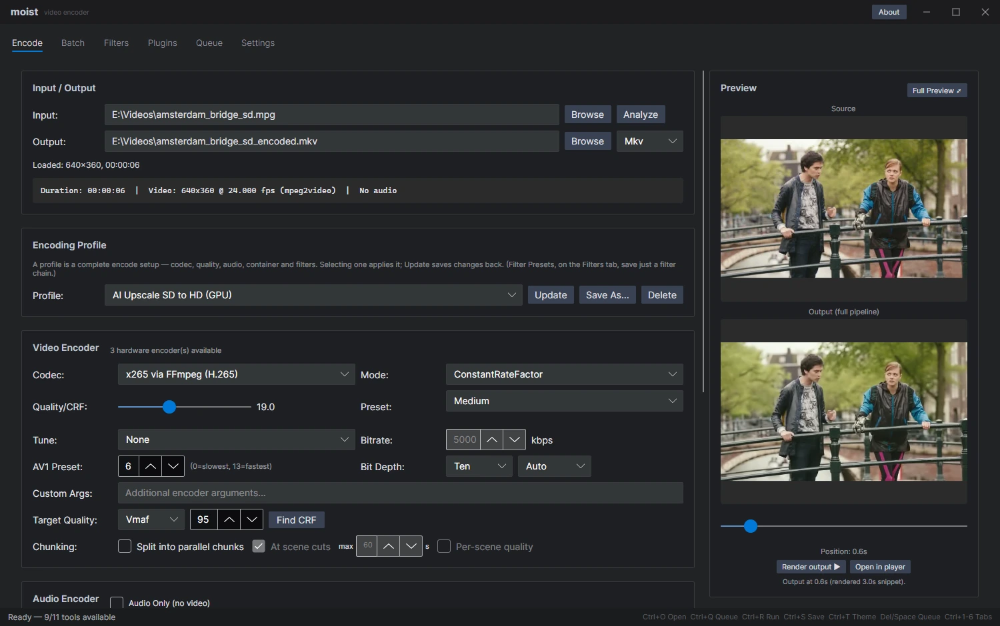
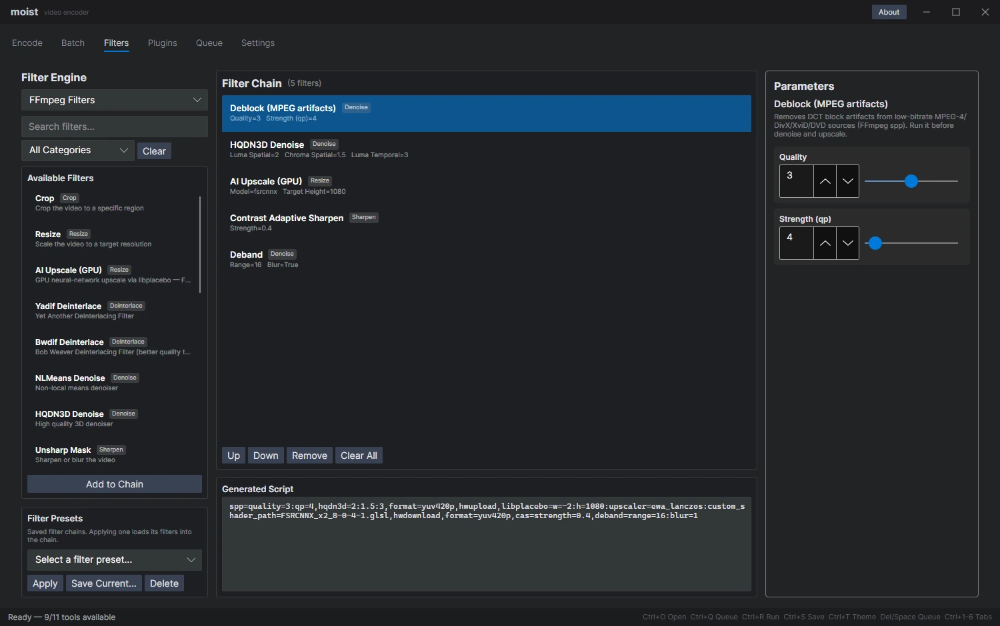

<p align="center">
  <picture>
    <source media="(prefers-color-scheme: dark)" srcset="docs/media/banner-dark.svg">
    
  </picture>
</p>

<p align="center">
  <a href="https://github.com/bogware/moist/releases/latest"></a>
  <a href="https://github.com/bogware/moist/actions/workflows/ci.yml"></a>
  
  
  <a href="LICENSE"></a>
</p>

<p align="center">
  <b>A cross-platform video encoder and restoration suite built on FFmpeg, x264, x265, SVT-AV1 and Real-ESRGAN.<br>
  Desktop application, command line, watch folders and an HTTP API — one pipeline behind all four.</b>
</p>

<p align="center">
  <a href="#restoration">Restoration</a> &nbsp;·&nbsp;
  <a href="#installation">Installation</a> &nbsp;·&nbsp;
  <a href="#target-quality">Target quality</a> &nbsp;·&nbsp;
  <a href="#verification">Verification</a> &nbsp;·&nbsp;
  <a href="docs/features.md">Feature guide</a> &nbsp;·&nbsp;
  <a href="docs/cli.md">Command line</a> &nbsp;·&nbsp;
  <a href="docs/faq.md">FAQ</a>
</p>

---

Most footage worth keeping was made a long time ago, on equipment nobody uses now, and it has
been copied badly ever since. You can squint at it and call it good enough. Or you can do the
work.

moist does the work. It restores old film and video with a deep neural upscaler or with the
classic tools, it encodes to the quality you ask for rather than the number you guess, and it
checks every result before it calls the job done. It does not trust an exit code. It does not
trust a container's word about what it holds. It counts the frames.

<p align="center">
  
  <br><sub>A DVD-era 640×360 source, restored to 1080p by the built-in <b>Film Restore to 1080p (Real-ESRGAN)</b> profile.
  <i>Tears of Steel</i> © Blender Foundation, CC BY 3.0 — degraded and re-encoded for demonstration.</sub>
</p>

## Restoration

<p align="center">
  
</p>

Every crop above is 1:1 at 1080p, from the same frame. Left, the source as a DVD would give it to
you. Centre, the **Classic** restore — traditional tools only. Right, the **Real-ESRGAN** restore —
the deep model, then the same film finish.

The Real-ESRGAN profile puts back what the transfer lost: the strands of hair, the line of an ear,
the ribbing on a jacket, the print on a shirt. The Classic profile can't invent that, and doesn't
try. It sharpens what is there, lifts the contrast the copy flattened, and finishes like film. It is
fast, it is faithful, and on a lot of material it is all you need.

**Both are built to look like film, not like video.** Restoration usually fails in the same place:
the denoiser. It takes the grain and the fine detail out with the noise, and what's left looks like
wax. So these profiles do not denoise. They clean compression damage with a light de-block and
nothing more. They sharpen with contrast-adaptive sharpening, which leaves no halos. They lift
contrast and colour a measured amount. And the last thing they do is lay down fine film grain —
moving grain, on the brightness only, the way film carries it — then encode with x265's `tune=grain`
so the encoder keeps it.

| Profile | Method | Time per minute of footage* |
|---|---|---|
| **Film Restore to 1080p (Real-ESRGAN)** | De-block → Real-ESRGAN ×4 → CAS → contrast → film grain. x265 10-bit, `tune=grain`. | about 17 minutes |
| **Film Restore to 1080p (Classic)** | De-block → CAS at source resolution → Lanczos → CAS → contrast → film grain. x265 10-bit, `tune=grain`. | about 7 minutes |
| AI Upscale SD to HD (GPU) | Neural shader upscale (FSRCNNX / Anime4K) in the same FFmpeg pass. Falls back to spline without a Vulkan GPU. | about 2 minutes |
| Broadcast 720p60 Film — Faithful 720p | For over-the-air captures of film-era television: native rate and size kept, bars cropped, grain kept, original audio untouched. | about 2 minutes |

<sub>*Measured on an RTX 4080 with a 16-thread CPU. The x265 encode is most of the
Classic and GPU figures; Real-ESRGAN is the GPU's work. Long sources stream through Real-ESRGAN in
windows, so a full feature runs in bounded disk space, and an interrupted run picks up where it stopped.</sub>

```bash
moist encode reel.mpg --profile "Film Restore to 1080p (Real-ESRGAN)"
moist encode reel.mpg --profile "Film Restore to 1080p (Classic)"
```

Telecined film gets its own treatment. Broadcast captures that were bob-deinterlaced to 60p carry
film's 3:2 cadence buried in them; moist's `ivtc` filter weaves the fields back together and recovers
the true 23.976 frames — nothing interpolated — and keeps the sound in sync across reception dropouts.

<p align="center">
  
  <br><sub>Select a profile and render the output preview. You see the real result — the whole pipeline, upscale included — before you spend an hour on it.</sub>
</p>

## Installation

Download a release from [Releases](https://github.com/bogware/moist/releases/latest). The builds are
self-contained; there is no runtime to install.

| | Desktop application | Command line |
|---|---|---|
| **Windows x64** | `moist-<version>-win-x64.zip` — run `Moist.App.exe` | `moist-cli-<version>-win-x64.zip` — `moist.exe` |
| **Linux x64** | `moist-<version>-linux-x64.tar.gz` — `./Moist.App` | `moist-cli-<version>-linux-x64.tar.gz` — `./moist` |
| **macOS** | [Build from source](docs/development.md#build-from-source) | [Build from source](docs/development.md#build-from-source) |

Each release publishes `SHA256SUMS.txt`. Verify before you run: `sha256sum -c SHA256SUMS.txt --ignore-missing`.

**FFmpeg** is required. Install it from **Settings → Prerequisites**, where every download is pinned
to a fixed build and checked against its SHA-256 before it is unpacked — or put it on your `PATH`
(`winget install Gyan.FFmpeg`, `brew install ffmpeg`, `sudo apt install ffmpeg`). A full build is
needed for SVT-AV1 and VMAF; `moist tools` reports what yours contains. Real-ESRGAN, RIFE and
MKVToolNix install the same way.

```bash
Moist.App.exe holiday.mov                          # open a file in the desktop application
moist encode holiday.mov                           # x265, Opus, Matroska
moist encode holiday.mov -o holiday.mp4 --target-vmaf 95
```

## Target quality

A CRF is a number with no units. CRF 23 tells you nothing about how *your* footage will look. So
don't pick one. Name the quality you want, and moist finds the setting that delivers it:

<p align="center">
  
</p>

It encodes short samples from across the file with the encoder and preset you will actually use,
scores each one with VMAF, and bisects to the target. The samples predict the whole file closely:

| | Predicted from 3 × 5 s samples | Measured on the full encode |
|---|---|---|
| VMAF | 93.39 | **93.46** |
| Size | 64 % of source | 61 % |

**Per-scene quality** goes further. `--chunked --per-scene --target-vmaf 95` gives every scene its
own CRF. Against a single CRF chosen so that no scene falls short, it delivers the same worst-case
quality at **15 % less size** — and it re-measures its own predictions, because how well a scene
compresses and how well it holds up to the eye are not the same thing.
[Read more](docs/features.md#per-scene-quality--the-same-quality-everywhere-not-the-same-effort).

## Verification

<p align="center">
  
</p>

A tool that reports success and hands back a damaged file is worse than one that fails. moist is
built on that understanding. It checks the work at every point where the work can go wrong:

| What goes wrong | What moist does |
|---|---|
| FFmpeg exits 0 having written a file a few frames short | Counts the frames of every chunked join and every AI pass; a mismatch fails the job |
| A container is asked to carry a codec it can't hold | Checks codec against container before encoding, from rules established by muxing every pair and re-probing |
| `ffmpeg -encoders` lists hardware the machine doesn't have | Test-encodes every hardware path and offers only the ones that work, with the reason for the rest |
| A broadcast cut starts its video a second after its audio | Reads each stream's start time and anchors the audio to the first video frame |
| A tool hangs on a dead network share | A watchdog kills any tool silent for fifteen minutes, and says so |
| A raw x265 stream is wrapped with the wrong timestamps | Verifies the timing of every wrap, and offers an mkvmerge wrap that keeps B-frames |
| The machine goes down in the middle of a batch | The queue returns on the next launch; chunked encodes resume from the last good chunk |

## Hardware

| | H.264 | H.265 | AV1 |
|---|:---:|:---:|:---:|
| NVIDIA NVENC | Yes | Yes | Yes (RTX 40 and later) |
| Intel Quick Sync † | Yes | Yes | Yes |
| AMD AMF † | Yes | Yes | Yes |
| Apple VideoToolbox † | Yes | Yes | — |
| VA-API (Linux) † | Yes | Yes | Yes |

NVENC is verified end to end on real hardware. † Implemented from the documented FFmpeg interfaces
and detected correctly, but not yet proven on that vendor's hardware; reports are welcome. On an RTX
4080, forty seconds of 1080p HEVC took **4.9 s** with NVENC against 85.1 s with x265, at the same
VMAF, for a file 28 % larger. Use the GPU for volume and the CPU for masters.

## The full toolbox

<table>
<tr>
<td width="50%" valign="top">

**Encode**
- x264, x265, SVT-AV1, VP9 and FFV1, through FFmpeg or the standalone x264 and x265 encoders
- CRF, constant quality, bitrate and two-pass; every preset and tune
- 8, 10 and 12-bit; 4:2:0, 4:2:2 and 4:4:4 — *Auto* keeps what the source has
- Opus, AAC, MP3, FLAC, AC3, E-AC3, Vorbis and passthrough
- Every audio track, chapters, fonts, HDR10 metadata — and, opt-in, Dolby Vision and HDR10+ dynamic metadata

</td>
<td width="50%" valign="top">

**Measure and automate**
- VMAF, XPSNR, SSIM and PSNR, with worst-frame and harmonic-mean scores
- `moist watch` — encode what arrives in a folder, once the copy has finished
- `moist health --deep` — decode a whole library and report the files damaged inside
- `moist serve` — an authenticated HTTP API over the queue, ready for Docker
- 18 built-in profiles, 30+ filter presets, plugins

</td>
</tr>
</table>

<p align="center">
  
  
  <br><sub>Left: build a filter chain and watch the script it generates. Right: every tool moist depends on, detected and versioned.</sub>
</p>

## Command line

```bash
moist encode film.mkv --target-vmaf 95 --measure                        # find the setting, then prove it
moist encode film.mkv --video-encoder hw-nvenc-hevc --audio-track all   # GPU encode, every audio track
moist encode reel.mpg --profile "Film Restore to 1080p (Classic)"       # traditional film restoration
moist encode film.mkv --chunked --per-scene --target-vmaf 95            # even quality, scene by scene
moist batch *.mkv --output-dir ./out --container mp4 --jobs 4 --keep-going
moist compare source.mkv encoded.mkv --metric vmaf
moist watch ./inbox --output-dir ./done --profile "Web - H.265 High Quality"
moist list hardware                                                     # what works on this machine
```

`--dry-run` prints every job and the exact FFmpeg command without encoding a frame. `--json` makes
every command machine-readable. [Full reference](docs/cli.md).

## Server and Docker

```bash
docker build -t moist .
docker run -p 7788:7788 -v /media:/media -e MOIST_TOKEN=change-me moist
```

The image runs `moist serve` as an unprivileged user, confined to `/media`. The API requires a token,
accepts only options that shape the encode — never a tool path or a raw argument — and resolves every
path inside a served root. See [SECURITY.md](SECURITY.md) for the full model.

## Documentation

| Guide | Contents |
|---|---|
| [Feature guide](docs/features.md) | Every feature in depth: target quality, per-scene, chunking, metrics, HDR, profiles, filters |
| [Command line](docs/cli.md) | Recipes, automation, the HTTP API, Docker, exit codes |
| [FAQ and troubleshooting](docs/faq.md) | Practical advice and fixes for common problems |
| [Development](docs/development.md) | Building from source, the test suites, architecture, extending moist |
| [Changelog](CHANGELOG.md) · [Security](SECURITY.md) | Release history, and how to report a vulnerability |

## Contributing

Issues and pull requests are welcome. Build with `cd src && dotnet build` and test with
`dotnet test`. The integration suite drives real FFmpeg encodes and skips itself when FFmpeg is
absent, so read the skip count before you trust a passing run. The
[development guide](docs/development.md) covers the architecture; [`CLAUDE.md`](CLAUDE.md) records
the reasoning behind each design decision, and the failures that taught it.

## Acknowledgements

moist stands on the work of
[FFmpeg](https://ffmpeg.org), [x264](https://www.videolan.org/developers/x264.html),
[x265](https://www.videolan.org/developers/x265.html), [SVT-AV1](https://gitlab.com/AOMediaCodec/SVT-AV1),
[libvmaf](https://github.com/Netflix/vmaf), [libplacebo](https://code.videolan.org/videolan/libplacebo),
[FSRCNNX](https://github.com/igv/FSRCNN-TensorFlow), [Anime4K](https://github.com/bloc97/Anime4K),
[Real-ESRGAN](https://github.com/xinntao/Real-ESRGAN), [RIFE](https://github.com/nihui/rife-ncnn-vulkan),
[MKVToolNix](https://mkvtoolnix.download), [dovi_tool and hdr10plus_tool](https://github.com/quietvoid)
and [Avalonia](https://avaloniaui.net).

Demonstration footage: [*Tears of Steel*](https://mango.blender.org) (2012) © Blender Foundation,
licensed [CC BY 3.0](https://creativecommons.org/licenses/by/3.0/). Frames were downscaled, degraded,
re-encoded and cropped for the comparisons above.

## License

[AGPL-3.0](LICENSE). You may use, change and share moist. If you run a modified version as a
network service, you share those changes too.

---

<p align="center"><i>The work is the same as it ever was. You do it right, or you do it over.</i></p>
